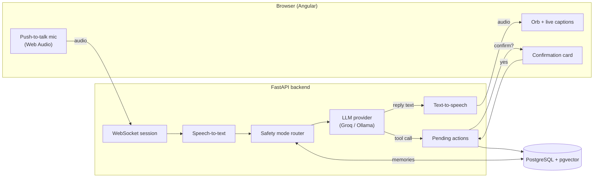

# Companion

**A voice-only AI companion that turns conversations into actions.**

You hold a button and talk. Your companion, a funny, teasing best friend who nags you to follow
through, talks back, remembers what matters to you, and turns "remind me to call mom tomorrow at
six" into a real reminder once you confirm it.

> Status: in active development. See the [roadmap](#roadmap).

## Highlights

- **Voice only.** Push-to-talk, an animated orb that reacts to audio, and live captions for both
  sides. There is no chat box.
- **Actions with consent.** The model proposes tasks, reminders and weekly plans. Nothing is
  saved until you say yes ([ADR 0004](docs/adr/0004-pending-actions.md)).
- **Safety enforced in code, not just prompts.** A mode router turns the banter off when you are
  struggling, and "stop teasing" is a hard switch ([ADR 0003](docs/adr/0003-safety-mode-router.md)).
- **Typed long-term memory.** Preferences, goals, commitments, habits and recent context, which
  you can view, edit and delete. Retrieval uses pgvector.
- **Model-agnostic and free to run.** Language, speech and embedding providers sit behind small
  interfaces: a hosted free tier or a fully offline local model, chosen by one setting
  ([ADR 0002](docs/adr/0002-ai-providers.md)).
- **Measured, not guessed.** Model choices are backed by a written spike
  ([local LLM spike](docs/spikes/local-llm-spike.md)) and an evaluation suite that grades the real
  model on personality, safety, tool use and honesty ([latest results](docs/evals/latest.md)).

## Architecture



## Tech stack

| Layer    | Technology                                                                 |
| -------- | -------------------------------------------------------------------------- |
| Frontend | Angular 22 (standalone, signals, zoneless), TypeScript strict, Web Audio API, Vitest |
| Backend  | Python 3.13, FastAPI, Pydantic v2, WebSockets, SQLAlchemy 2, Alembic, uv   |
| Data     | PostgreSQL 17 + pgvector                                                   |
| AI       | Pluggable providers: Groq (default), Ollama (offline)                      |
| Quality  | pytest, Vitest, Playwright, mypy `--strict`, ruff, ESLint, Prettier, GitHub Actions |
| Run      | Docker Compose                                                             |

## Getting started

Prerequisites: Docker, Python 3.13 with [uv](https://docs.astral.sh/uv/), and Node 24.

```bash
# 1. Database (Postgres + pgvector on localhost:5433)
docker compose up -d db

# 2. Backend on http://localhost:8000 (interactive docs at /docs)
cd backend
uv sync
uv run alembic upgrade head
uv run uvicorn companion.main:app --reload --timeout-graceful-shutdown 3

# 3. Frontend on http://localhost:4200
cd frontend
npm ci
npm start
```

Configuration is read from environment variables; see [`.env.example`](.env.example). Every
setting has a safe default, so the app and the test suite run without any secrets.

### Talk to the companion

Open <http://localhost:4200>, then hold the **Hold to talk** button (or the space bar) and speak.
The orb listens, thinks and talks back, with live captions for both sides.

- **My room** keeps today's tasks, plan and reminders beside the companion; tick tasks off right
  there. Reminders chime, are spoken aloud and can pop up as system notifications.
- **Quest log** shows every task, reminder and weekly plan you confirmed, including routines
  that repeat on chosen days.
- **Diary** shows what the companion remembers about you, and lets you edit or delete it.
- **Dev** (development builds only) is a text chat that also shows the safety mode chosen for
  each reply.

It needs a language model, either a free [Groq](https://console.groq.com/keys) key or
[Ollama](https://ollama.com) running locally, plus the voice model files:

```bash
cp .env.example backend/.env    # then set LLM_PROVIDER (and GROQ_API_KEY for Groq)
ollama pull qwen3:4b-instruct-2507-q4_K_M   # only for LLM_PROVIDER=ollama
ollama pull all-minilm                      # embeddings for memory (EMBEDDING_PROVIDER=ollama)
# the companion's voice (TTS_PROVIDER=kokoro): about 120 MB into backend/.models/kokoro/
curl -L --create-dirs -o backend/.models/kokoro/kokoro-v1.0.int8.onnx \
  https://github.com/thewh1teagle/kokoro-onnx/releases/download/model-files-v1.0/kokoro-v1.0.int8.onnx
curl -L -o backend/.models/kokoro/voices-v1.0.bin \
  https://github.com/thewh1teagle/kokoro-onnx/releases/download/model-files-v1.0/voices-v1.0.bin
```

Ask for a reminder, a task or a weekly plan to see the confirmation card: nothing is saved
until you say yes or press Save.

The app runs as a single local user for now: the pages talk to the backend's development
endpoints, which only exist when `DEV_TEXT_CHANNEL=true` and never in production. Accounts are
on the list of next steps.

## Quality checks

```bash
# Backend
cd backend
uv run ruff check . && uv run ruff format --check . && uv run mypy && uv run pytest --cov

# Frontend
cd frontend
npm run lint && npm run format:check && npm run test:ci && npm run build
```

The same checks run in [CI](.github/workflows/ci.yml) on every push and as
[pre-commit hooks](.pre-commit-config.yaml) locally. Tests use fake AI providers, so they are
deterministic, offline and free.

### End-to-end test

```bash
cd frontend
npx playwright install chromium   # once
npm run e2e
```

Playwright starts its own backend (scripted fake AI, its own `companion_e2e` database) and
frontend on ports 8100 and 4300, then holds the talk button with a fake microphone: the spoken
request becomes a confirmation card, is saved, and shows up in the quest log. It also runs in CI.

### Evaluation suite

```bash
cd backend
uv run python -m evals                     # every case, once
uv run python -m evals --runs 3            # each case three times
uv run python -m evals --category safety   # one category
```

Unit tests prove the code works; the evaluation suite checks how the **real model** behaves. It
holds realistic conversations (a skipped workout, grief, a crisis, a body roast, several tasks at
once, a weekday routine, a weekly schedule) and grades each reply. Code checks everything it can,
such as the safety mode, the tool calls, the repeat days and banned body comments; a judge prompt
is used only for tone. It needs a real model in `backend/.env`, makes a few dozen calls, and
writes [docs/evals/latest.md](docs/evals/latest.md). Run it after changing the prompt, the
personality or the model.

## Project structure

```text
.
├── backend/              FastAPI service
│   ├── config/           personality.md (the companion's voice and rules)
│   ├── db/init/          one-time database setup (pgvector extension)
│   ├── src/companion/    application code
│   ├── evals/            evaluation suite: graded conversations against the real model
│   ├── e2e/              backend with scripted fakes for the end-to-end test
│   └── tests/
├── frontend/src/app/
│   ├── talk/             the room: voice conversation with today's tasks and reminders
│   ├── orb/              the animated orb, driven by state and voice level
│   ├── scene/            the animated pixel room backdrop
│   ├── layout/           top bar, page frame and side cards
│   ├── ui/               shared building blocks: button, panel, checkbox, filter, icon
│   ├── session/          WebSocket session, protocol and push-to-talk, shared by all pages
│   ├── voice/            microphone recorder and gapless audio player (Web Audio API)
│   ├── plans/ memories/  quest log and diary pages, and the task and reminder rows
│   └── dev/              developer text chat, compiled out of production builds
├── frontend/e2e/         Playwright end-to-end test
├── docs/
│   ├── adr/              architecture decision records
│   ├── evals/            latest evaluation results
│   └── spikes/           time-boxed experiments and their findings
├── .github/workflows/    CI
└── docker-compose.yml
```

## Roadmap

- [x] **0. Foundations:** monorepo, CI, linting, Docker Compose, decision records
- [x] **1. Conversation core:** provider interfaces and fakes, dev text channel, personality, mode router
- [x] **2. Actions:** tasks, reminders and weekly plans with the confirmation flow
- [x] **3. Memory:** typed extraction, pgvector retrieval, view, edit and delete API
- [x] **4. Voice:** Groq Whisper speech-to-text, Kokoro voice, audio over the WebSocket
- [x] **5. Interface:** pixel room, orb, push-to-talk, captions, quest log and diary
- [x] **6. Evals and end-to-end tests:** personality and safety eval suite, Playwright
- [ ] **7. Polish:** demo video, final documentation

### Next steps

- Accounts: invite-only sign-in, so the dev channel can become the real user channel
- Per-user usage limits on the language model and speech services
- Offline speech-to-text with a local Whisper model

## Documentation

- [Architecture decisions](docs/adr/README.md)
- [Reminder delivery](docs/adr/0006-reminder-delivery.md)
- [Routines and weekly plans](docs/adr/0008-routines-and-weekly-plans.md)
- [Typed long-term memory](docs/adr/0007-typed-memory.md)
- [Spike: a small local model as the brain](docs/spikes/local-llm-spike.md)
- [Evaluation results](docs/evals/latest.md)
- [Companion personality](backend/config/personality.md)

## Disclaimer

The companion is a productivity coach, not a therapist or medical professional, and it does not
give medical advice. If you are struggling, please reach out to people you trust or to a
professional.

## License

[MIT](LICENSE)
